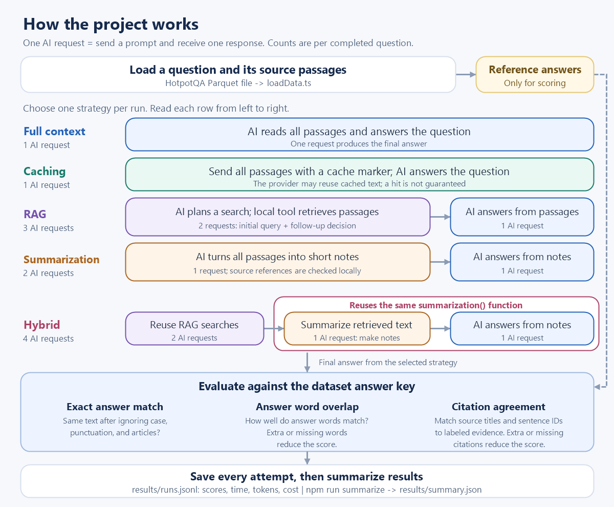

# Context Engineering

A TypeScript research project comparing five ways to prepare context for HotpotQA questions:
full context, prompt caching, RAG, summarization, and hybrid retrieval with summarization.

## Project flow



[Editable diagram](doc/project-flow.svg)

## Setup

1. Use Node.js 24 or newer and run `npm ci` from the project root.
2. Place the HotpotQA validation file at `data/validation-00000-of-00001.parquet`.
3. Create a local `.env` using `.env.example` and add your OpenRouter key:

   ```dotenv
   OPENROUTER_API_KEY=your_key_here
   OPENROUTER_MODEL=google/gemini-3.1-flash-lite
   OPENROUTER_PROVIDER=google-ai-studio
   LOG_LEVEL=info
   ```

The provider setting is optional for ordinary requests. The explicit caching strategy
requires one of its configured model/provider combinations. Keep your real key in `.env`.

## Run a strategy

Run all commands from the project root. These commands call the model and may incur API costs.

| Strategy | What it does | Command | AI requests per completed question |
| --- | --- | --- | --- |
| [Full context](src/strategies/full-context/README.md) | Sends all passages | `npm run ask` | 1 answer |
| [Caching](src/strategies/caching/README.md) | Sends all passages with a cache request | `npm run ask:caching` | 1 answer |
| [RAG](src/strategies/rag/README.md) | Uses model-requested searches, then answers | `npm run ask:rag` | 2 search-planning + 1 answer |
| [Summarization](src/strategies/summarization/README.md) | Summarizes passages, then answers | `npm run ask:summarization` | 1 summary + 1 answer |
| [Hybrid](src/strategies/hybrid/README.md) | Retrieves passages, summarizes them, then answers | `npm run ask:hybrid` | 2 search-planning + 1 summary + 1 answer |

An **AI request** (also called a model call) is one trip to the model service: send messages and receive a response.
For example, summarization needs one request to make notes and another to answer from them.
The application runs local retrieval and scoring without making extra AI requests.

Hybrid reuses the RAG search phase, then passes the retrieved passages to the same
`summarization()` function: make notes, check source references, and answer from those notes.

By default, a command runs one question at row 0. Add flags to choose a batch:

```powershell
npm run ask:hybrid -- --count 50 --start 10
npm run ask:caching -- --count 50 --start 10 --repetitions 3
```

- `--count`: number of consecutive questions.
- `--start`: zero-based starting row; `10` skips the first ten rows.
- `--repetitions`: attempts per question before moving to the next question.

Use the same model, provider, question range, and repetitions when comparing strategies.
Every attempt is saved. A failed or unsupported attempt stops the batch; there are no automatic retries.

## Results and scoring

Attempts are appended to `results/runs.jsonl`. Each command has its own `runId`.
Saved records include answers, scores, model calls, latency, tokens, reported cost, and cache measurements.
Usage includes preparation calls such as searches and summarization. Missing measurements stay unknown.

```powershell
npm run summarize
npm run summarize -- --run-id YOUR_RUN_ID
```

This prints a table and writes `results/summary.json`, without calling the model.

- **Accuracy (exact match):** how often the answer text matches the reference after ignoring case, ASCII punctuation, articles, and extra spaces.
- **Answer F1:** how well the answer words overlap the reference. Extra or missing words reduce the score.
- **Citation F1:** how well the cited source titles and sentence numbers match the labeled evidence. Extra or missing citations reduce the score.

These scores measure reference agreement. They do not independently verify factual correctness.
Reference answers and supporting labels are kept out of model requests.

## Project folders

```text
src/                 Shared loading, prompts, model client, scoring, and runner
src/strategies/      One folder and README per strategy
data/                Source Parquet file and optional prepared JSON
results/             Saved attempts and results summary
tests/               Automated tests
scripts/             Manual data inspection
doc/                 Project flow image and course documents
```

All strategies share `callModel.ts` (OpenAI SDK through OpenRouter), Zod schemas,
the final-answer instructions, and the same scoring functions.

## Local checks

```powershell
npm run load-data       # Export the first ten questions and a separate answer key
npm run preview-prompt  # Preview the first full-context prompt
npm run preview-rag     # Preview local keyword retrieval
npm test
npm run typecheck
```

These checks make no model requests. Set `LOG_LEVEL=debug` for more detailed logs.
Each current question uses its own source passages; larger shared-context, position,
and distraction experiments are still needed for the wider research question.
