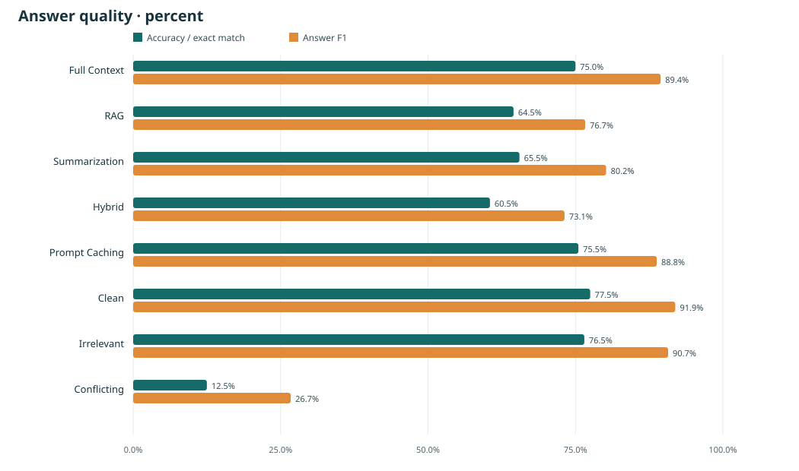
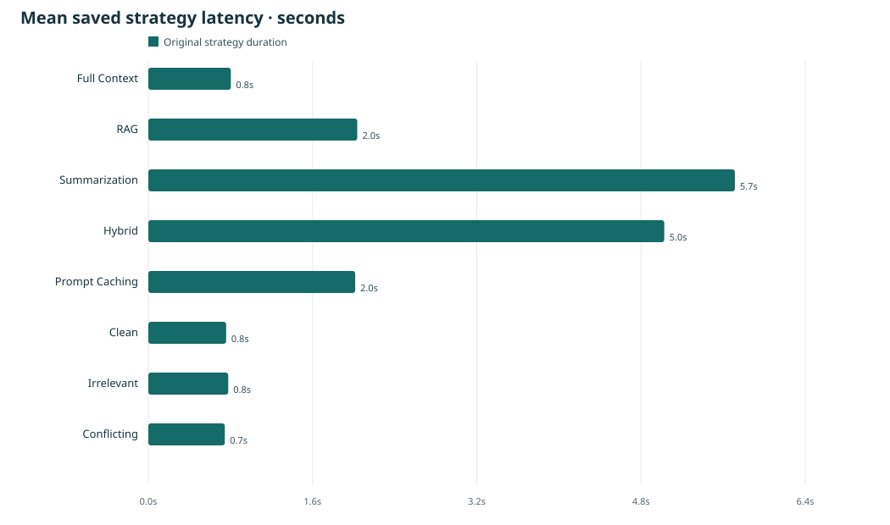
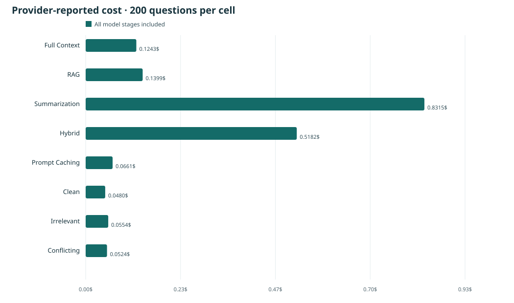

# Context engineering: final 200-question comparison

**Verification: PASS.** 2,800 durable API responses; 1,600 completed evaluations; eight cells × the same ordered 200 new question IDs. Zero failed/missing evaluations, duplicate request slots, duplicate provider generation IDs or unresolved billing intents. No API calls were made for this audit.

## Research objectives and methodology

This study evaluates answer quality, evidence citation, latency, token use and reported cost for five unchanged context-engineering implementations, and separately tests robustness to irrelevant and conflicting additions. The eight cells are two related experiments, not a five-strategy-by-three-noise factorial design.

The final revision-3 cohort contains 200 new, purposively selected HotpotQA distractor-validation questions in ascending dataset-row order. Every cell uses exactly these 200 question IDs in the same manifest order. Historical benchmark IDs and the original 20 pilot IDs are excluded. Seven invalid, five ambiguous and two unsupported-gold items were replaced before execution; the final source-grounded semantic review passed.

Dataset: data/distractor-validation.parquet; 7,405 rows. Dataset SHA-256: c20b638ca82b21d04fe12e14ff417ad05153d4d215a65de54497fca4e972f7c6. The five-strategy benchmark uses each question’s original distractor context; noise cells use complete supporting passages, with the specified addition. Gold/reference labels are not supplied as separate answer metadata; the source text and synthetic contradiction can naturally contain the answer string.

Model: google/gemini-3.1-flash-lite, Google AI Studio through OpenRouter, provider restricted to google-ai-studio, fallbacks disabled and require_parameters enabled. Benchmark temperature and output limit were omitted to preserve the original implementation defaults. Noise temperature is 0 and max_tokens is 1,024. All request configurations were checked from saved payloads. No model calls were made to produce this report.

Execution interval from durable request logs: 2026-11-23T20:38:37.238Z to 2026-11-23T21:53:36.796Z (UTC). One final evaluation per question per cell, no repeated sampling. The successful call pattern is 1 / 3 / 2 / 4 / 1 for Full Context / RAG / Summarization / Hybrid / Prompt Caching, plus one call per noise cell: 2,800 calls and 1,600 final evaluations.

Accuracy is the unchanged HotpotQA normalized exact match (EM). Answer F1 is normalized token overlap with yes/no/noanswer category handling. Citation precision/recall/F1 compare unique exact passage-title / original zero-based sentence-ID pairs with the original reference labels. All F1 and precision/recall summaries are per-question macro means. Citation F1 is averaged directly rather than computed from aggregate precision/recall.

Every final output was parsed directly from its durable final raw response, checked against the saved output and rescored with the original scorer and an independent implementation. All adaptive intermediate requests, tool retrieval results, summaries and final answers were reconstructed locally against their exact saved request hashes using a mock transport. This is saved-response reconstruction; it neither reruns a model nor contacts an endpoint.

Token and cost totals come from all durable HTTP receipts, including intermediate search and summary calls. Cost is the reported usage.cost in USD, not a recomputation from list prices or a reconciled account invoice. Zero unresolved intents and complete cost fields establish zero unknown billing in the local ledger. The audit cannot inspect external billing systems.

Latency reports the original saved strategy latencyMs. For multi-stage strategies it includes local retrieval and all model stages; single-stage values cover their original call duration. Client timing may include checkpoint replay, so it is not server-only or randomized latency evidence. A separate intent-to-receipt transport-sum metric is included in the CSV. P95 uses linear interpolation.

Paired comparisons match question IDs within the five-strategy experiment and within the three noise conditions. Deltas are right minus left. Wins/losses refer to EM improvement/degradation, ties to unchanged EM. Accuracy and answer-F1 paired percentile bootstrap intervals use 5,000 deterministic resamples (xorshift32 seed 0x083b0271). Exact two-sided McNemar p-values use discordant pairs. Intervals and p-values are exploratory and unadjusted for 13 comparisons; no confirmatory significance claim is made.

## Strategies and noise conditions

| Cell | Implementation / context |
|---|---|
| Full Context | One structured answer call over all ten supplied distractor passages. |
| RAG | Two tool-search/planning calls and one structured answer call using retrieved passages. Search is local to each question’s supplied context. |
| Summarization | One question-independent source-summary call, then one answer call. Original source and sentence identifiers are retained. |
| Hybrid | Two tool-search calls, one summary call over retrieved passages, then one answer call. |
| Prompt Caching | Same full-context source blocks and question as Full Context, with an explicit ephemeral cache breakpoint on the source block; one call per question. |
| Clean | Full Context with complete gold-supporting passages only. |
| Irrelevant | Clean context plus one distinct, reviewed unrelated original passage. |
| Conflicting | Clean context plus a reviewed synthetic passage that asserts an alternative for the exact requested fact and explicitly excludes the gold answer. |

## Key findings

- The highest observed five-strategy accuracy is 75.50% (151/200), achieved by Prompt Caching. This describes this cohort and one observation per condition.

- Prompt Caching has the lowest reported strategy cost ($0.066139 for 200 questions); Full Context has the lowest saved mean strategy latency (0.805 seconds).

- Clean accuracy is 77.50%; Irrelevant is 76.50% (-1.00 pp versus Clean); Conflicting is 12.50% (-65.00 pp versus Clean). These comparisons use the same questions and the same noise-run settings.

- Provider receipts report 412,311 cached input tokens across all 2,800 calls. Requested cache metadata alone is not evidence of a cache hit; the table uses reported cached_tokens.

- Actual provider-reported cost is $1.835933, versus the pre-run heuristic estimate of $1.847188. All multi-stage requests are included in the measured totals.

## Accuracy, answer F1 and citation metrics

| Condition | N | Correct | Accuracy / EM | Answer F1 | Citation precision | Citation recall | Citation F1 |
|---|---|---|---|---|---|---|---|
| Full Context | 200 | 150 | 75.00% | 89.44% | 90.27% | 74.42% | 78.88% |
| RAG | 200 | 129 | 64.50% | 76.65% | 79.00% | 64.50% | 68.81% |
| Summarization | 200 | 131 | 65.50% | 80.20% | 82.19% | 69.67% | 72.96% |
| Hybrid | 200 | 121 | 60.50% | 73.15% | 76.83% | 62.92% | 66.86% |
| Prompt Caching | 200 | 151 | 75.50% | 88.78% | 90.68% | 73.87% | 78.71% |
| Clean | 200 | 155 | 77.50% | 91.93% | 95.29% | 76.25% | 82.07% |
| Irrelevant | 200 | 153 | 76.50% | 90.71% | 93.75% | 76.25% | 81.72% |
| Conflicting | 200 | 25 | 12.50% | 26.73% | 32.21% | 28.92% | 29.49% |

## Latency, token usage and reported cost

| Condition | API calls | Mean latency (s) | Median (s) | P95 (s) | Input tokens | Output tokens | Total tokens | Reported cost USD |
|---|---|---|---|---|---|---|---|---|
| Full Context | 200 | 0.805 | 0.810 | 0.985 | 417,159 | 13,370 | 430,529 | $0.124345 |
| RAG | 600 | 2.038 | 2.008 | 2.370 | 438,429 | 20,213 | 458,642 | $0.139927 |
| Summarization | 400 | 5.721 | 5.739 | 7.698 | 685,539 | 440,083 | 1,125,622 | $0.831509 |
| Hybrid | 800 | 5.033 | 4.804 | 6.809 | 600,664 | 245,364 | 846,028 | $0.518212 |
| Prompt Caching | 200 | 2.018 | 1.656 | 2.511 | 417,359 | 13,473 | 430,832 | $0.066139 |
| Clean | 200 | 0.759 | 0.737 | 0.992 | 145,841 | 7,691 | 153,532 | $0.047997 |
| Irrelevant | 200 | 0.779 | 0.736 | 0.953 | 175,088 | 7,760 | 182,848 | $0.055412 |
| Conflicting | 200 | 0.746 | 0.734 | 0.926 | 167,771 | 6,967 | 174,738 | $0.052393 |

Total: **3,047,850 input tokens + 754,921 output tokens = 3,802,771 total tokens; $1.835933 reported USD.**

## Observed prompt-cache reads

| Condition | Cache-read coverage | Requests with reads | Request hit rate | Read tokens | Read-token fraction | Write tokens |
|---|---|---|---|---|---|---|
| Full Context | 200/200 | 0 | 0.00% | 0 | 0.00% | 0 |
| RAG | 600/600 | 0 | 0.00% | 0 | 0.00% | 0 |
| Summarization | 400/400 | 0 | 0.00% | 0 | 0.00% | 0 |
| Hybrid | 800/800 | 0 | 0.00% | 0 | 0.00% | 0 |
| Prompt Caching | 200/200 | 200 | 100.00% | 412,311 | 98.79% | 412,311 |
| Clean | 200/200 | 0 | 0.00% | 0 | 0.00% | 0 |
| Irrelevant | 200/200 | 0 | 0.00% | 0 | 0.00% | 0 |
| Conflicting | 200/200 | 0 | 0.00% | 0 | 0.00% | 0 |

Hit rate = API requests with positive reported cached_tokens / requests with a known cached_tokens field. Read-token fraction = cached input tokens / total input tokens. These are observed provider fields, not proof of causal cache savings.

## Paired comparisons

| Left → right (right − left) | N | Wins / losses / ties | Δ accuracy | 95% paired CI (pp) | Δ answer F1 | Δ citation F1 | Δ mean latency (s) | Δ mean cost USD | Exact McNemar p |
|---|---|---|---|---|---|---|---|---|---|
| Full Context → RAG | 200 | 8 / 29 / 163 | -10.50 pp | -16.50 to -4.50 | -12.79 pp | -10.07 pp | 1.233 | $0.000078 | 0.0007529 |
| Full Context → Summarization | 200 | 9 / 28 / 163 | -9.50 pp | -15.50 to -4.00 | -9.25 pp | -5.93 pp | 4.916 | $0.003536 | 0.002563 |
| Full Context → Hybrid | 200 | 7 / 36 / 157 | -14.50 pp | -20.50 to -8.50 | -16.29 pp | -12.02 pp | 4.228 | $0.001969 | 0.000008963 |
| Full Context → Prompt Caching | 200 | 5 / 4 / 191 | +0.50 pp | -2.50 to 3.50 | -0.66 pp | -0.18 pp | 1.213 | $-0.000291 | 1.000 |
| RAG → Summarization | 200 | 30 / 28 / 142 | +1.00 pp | -6.50 to 8.50 | +3.55 pp | +4.15 pp | 3.683 | $0.003458 | 0.8957 |
| RAG → Hybrid | 200 | 13 / 21 / 166 | -4.00 pp | -9.50 to 1.50 | -3.50 pp | -1.95 pp | 2.995 | $0.001891 | 0.2295 |
| RAG → Prompt Caching | 200 | 28 / 6 / 166 | +11.00 pp | 5.50 to 17.00 | +12.13 pp | +9.90 pp | -0.020 | $-0.000369 | 0.0001951 |
| Summarization → Hybrid | 200 | 17 / 27 / 156 | -5.00 pp | -11.50 to 1.00 | -7.05 pp | -6.10 pp | -0.689 | $-0.001566 | 0.1742 |
| Summarization → Prompt Caching | 200 | 31 / 11 / 158 | +10.00 pp | 4.00 to 16.00 | +8.58 pp | +5.75 pp | -3.703 | $-0.003827 | 0.002887 |
| Hybrid → Prompt Caching | 200 | 39 / 9 / 152 | +15.00 pp | 8.50 to 21.50 | +15.63 pp | +11.84 pp | -3.015 | $-0.002260 | 0.00001522 |
| Clean → Irrelevant | 200 | 1 / 3 / 196 | -1.00 pp | -3.00 to 1.00 | -1.22 pp | -0.35 pp | 0.020 | $0.000037 | 0.6250 |
| Clean → Conflicting | 200 | 1 / 131 / 68 | -65.00 pp | -71.50 to -58.00 | -65.20 pp | -52.58 pp | -0.013 | $0.000022 | 4.886e-38 |
| Irrelevant → Conflicting | 200 | 1 / 129 / 70 | -64.00 pp | -70.50 to -57.00 | -63.99 pp | -52.23 pp | -0.033 | $-0.000015 | 1.925e-37 |

Deltas are right minus left; 200 matched questions per comparison. Bootstrap CIs and McNemar p-values are exploratory and unadjusted. Full answer-F1 CIs and token deltas are in the paired-comparisons exports.

## Research limitations

- The manually curated 200-question cohort is not a random or representative HotpotQA sample. Conclusions apply to this cohort, frozen evidence, model, provider and implementations.

- One response per question and condition provides no estimate of repeated-run model variance. Sequential execution and provider load/cache state can confound latency and cache comparisons.

- Noise uses gold-selected complete supporting passages, fixed appended noise, one unrelated donor and one synthetic contradiction per question. Synthetic text explicitly negates the gold answer; this does not establish robustness to natural misinformation, adversarial sources, passage reordering or arbitrary context lengths.

- Clean versus noisy cells are controlled within their own configuration. Comparing them directly with the five-strategy benchmark confounds context selection and generation settings.

- Exact match and token F1 can penalize correct paraphrases, extra qualifiers and alternative date/name forms. Six supported scoring-limit cases remain unchanged and are documented. No semantic adjudication or gold-answer change was applied after observing results.

- Citation metrics measure agreement with labeled support pairs, not independent factual truth, entailment or every potentially valid alternate supporting sentence. Summaries can omit or distort evidence.

- Cache-breakpoint requests do not prove cache acceptance. Full Context may also receive automatic caching. Read-hit rates use provider-reported positive cached_tokens per API request; unknown fields would remain missing. This workload does not isolate cold/warm cache reuse or guaranteed savings.

- Offline integrity checks verify internal consistency and immutable receipts; they do not independently authenticate the provider’s measurements or reconcile credit-card charges, taxes, fees or outside requests.

- Saved source-relative “current” facts are evaluated against the frozen dataset snapshot rather than present-day world knowledge. No external factual verification was performed during reporting.

- Bootstrap intervals condition on the selected cohort, and multiple comparisons are unadjusted. Observed ranks and p-values do not establish general superiority or causation.

## Conclusion

The saved evidence supports a complete, internally consistent comparison of all eight 200-question cells: 2,800 successful API receipts and 1,600 completed evaluations, with no missing results, duplicate request slots or unresolved billing in the local ledger. Prompt Caching reaches 75.50% observed accuracy; cost, citation quality and latency should be assessed alongside accuracy using the tables and paired differences. The noise experiment quantifies sensitivity to the two curated additions under its own fixed settings. Historical results and the original pilot remain separate and unchanged. These results support cohort-specific findings, with the sampling, scoring, caching and timing limits described above.

## Evidence organization and raw result references

Raw results remain at their original immutable paths. This report adds a logical index and a SHA-256 inventory rather than moving, renaming or rewriting evidence. Historical runs, the original pilot and superseded preparations are excluded from all new-cohort metrics. The prepared missing.json and combined-existing.json describe the pre-execution plan and are retained as historical preparation evidence; runtime/combined.json describes the completed execution.

| Evidence | Repository-relative location |
|---|---|
| Approved cohort, model settings and code hashes | experiments/expansion/prepared/manifest.json |
| Exact inputs, references, order and expected call counts | experiments/expansion/prepared/tasks.json |
| All 200 question IDs | experiments/expansion/prepared/selected-question-ids.txt |
| Noise fixtures and complete semantic review | experiments/expansion/prepared/noise-review.md |
| Frozen semantic review decisions | experiments/expansion/prepared/semantic-review-decisions.json |
| Documented strict scoring limitations | experiments/expansion/prepared/scoring-limitations.md |
| Raw request intents and durable HTTP response bodies | experiments/expansion/runtime/fdda1f0b5ebe9c4c51f636443730d200ada3876f5de0e79e5c49bb5874df5110/requests/ |
| Immutable evaluation outputs, intermediate calls and scores | experiments/expansion/runtime/fdda1f0b5ebe9c4c51f636443730d200ada3876f5de0e79e5c49bb5874df5110/results/ |
| Original executor’s combined aggregation | experiments/expansion/runtime/fdda1f0b5ebe9c4c51f636443730d200ada3876f5de0e79e5c49bb5874df5110/combined.json |
| Historical benchmark evidence (excluded) | experiments/expansion/evidence/origin-f62ad872d665f298ab3590c594ceb6b298058843.jsonl.gz |
| Earlier historical CSV experiments (excluded) | results/ |
| Original 20-question / 60-response pilot (excluded) | experiments/context-noise/results/4a93b88d-81b4-45ff-9444-348852054b1f/runs.jsonl |
| Frozen copy of original pilot | experiments/expansion/evidence/noise-pilot-runs.jsonl |
| Prior superseded preparations (excluded) | experiments/expansion/superseded/ |
| Existing historical research report (excluded) | reports/context-engineering-complete-research-report.html |
| Reproducible saved-evidence auditor | scripts/final-comparison-report.mjs |

Derived audit files: final-comparison-evidence/verification.json, summary.json, condition-summary.csv, paired-comparisons.{json,csv}, source-inventory.json and result-index.json. The main final-comparison-results.csv has 1,600 evaluation rows, exact answers/scores, resource measurements and raw artifact pointers.

Manifest SHA-256: `fdda1f0b5ebe9c4c51f636443730d200ada3876f5de0e79e5c49bb5874df5110`. Fixtures SHA-256: `e58fe6e6891bce8bfa9df3e867e4ac5e06b24d986ef37cd9f29df72724b5ff61`. Original scorer SHA-256: `1cc1efc69558a87002248157428dfd14fe3d44c4c8b45ec9a89c6a1c74ae6b43`.
